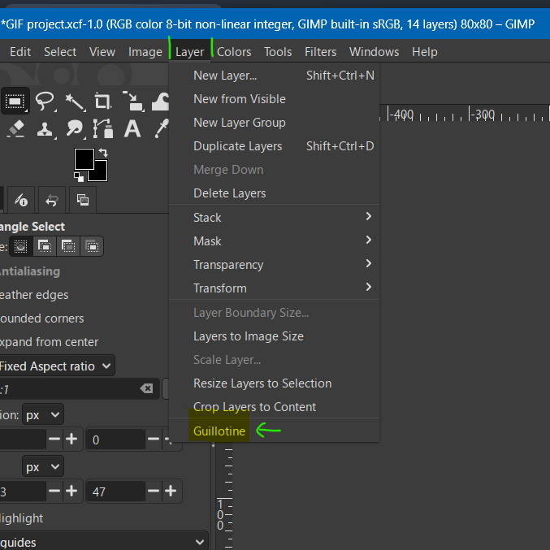

# ofn-guillotine-layer (GIMP 3.x / 3.2)

A port of the **ofn-guillotine-layer** plug-in (originally written by *Ofnuts* for GIMP 2.x) adapted for **GIMP 3.x / 3.2** using Python 3 and GObject Introspection (`gi.repository.Gimp`).

> **Disclaimer:** This plug-in is an unofficial adaptation provided "as is." Proper operation is **not 100% guaranteed** across all operating systems, edge cases, layer types, or future GIMP 3.x releases. Always save a backup of your work before running it.

---

## How It Works

This plug-in implements behavior similar to GIMP's built-in **Image > Guillotine** (Slice Using Guides) at the **layer** level:

- Reads all horizontal and vertical guides present in the active image.
- Slices the selected layer(s) into new sub-layers corresponding to each grid cell defined by the guides.
- Skips cells that do not intersect the layer bounds (useful for layers smaller than or offset from the canvas).
- Names each generated sub-layer using the format `<LayerName> @ (x,y)`.
- Preserves the **parent layer group** if the active layer is nested inside one.
- Keeps the original layer in the stack and marks it as **invisible**.
- Wraps the entire operation in a single undo group (`Ctrl+Z` reverts all generated slices at once).
- Supports GIMP 3.x **multi-layer selection**.

---

## Project Structure

```text
ofn-guillotine-layer/
├── ofn-guillotine-layer.py     # GIMP 3.x / 3.2 plug-in source code
└── ofn-guillotine-layer.html   # Reference documentation
```

> **Note:** In GIMP 3.x, Python plug-ins **cannot** be placed directly inside the root `plug-ins` directory. The `.py` script must reside inside a dedicated subfolder sharing the exact same name (`ofn-guillotine-layer/ofn-guillotine-layer.py`).

---

## Installation (GIMP 3.2)

### Windows (Verified Path)

1. Copy the entire `ofn-guillotine-layer` folder into your GIMP 3.2 user `plug-ins` directory:

   ```text
   C:\Users\<LocalUser>\AppData\Roaming\GIMP\3.2\plug-ins\ofn-guillotine-layer\
   ```

   *(Shortcut in File Explorer: press `Win + R`, enter `%APPDATA%\GIMP\3.2\plug-ins`, and press Enter.)*

2. Confirm the final directory structure matches:

   ```text
   C:\Users\<LocalUser>\AppData\Roaming\GIMP\3.2\plug-ins\
   └── ofn-guillotine-layer\
       ├── ofn-guillotine-layer.py
       └── ofn-guillotine-layer.html
   ```

3. Fully close and restart GIMP 3.2.

### Linux and macOS

1. Copy the `ofn-guillotine-layer` folder into your GIMP user `plug-ins` directory:
   - **Linux (native):** `~/.config/GIMP/3.2/plug-ins/ofn-guillotine-layer/`
   - **Linux (Flatpak):** `~/.var/app/org.gimp.GIMP/config/GIMP/3.2/plug-ins/ofn-guillotine-layer/`
   - **macOS:** `~/Library/Application Support/GIMP/3.2/plug-ins/ofn-guillotine-layer/`
2. Grant executable permission to the Python script:
   ```bash
   chmod +x ofn-guillotine-layer.py
   ```
3. Restart GIMP.

> **Tip:** To verify the exact `plug-ins` directories your local GIMP installation scans, open **Edit > Preferences > Folders > Plug-ins**.

---

## Usage

1. Open an image in GIMP 3.2.
2. Add horizontal and/or vertical guides (by dragging from the rulers or via **Image > Guides**).
3. In the **Layers** dockable dialog, select one or more layers to slice.
4. From the top menu bar, click **Layer > Guillotine**.
5. The plug-in takes no dialog parameters: the sliced sub-layers are immediately created at the top of the layer stack (or parent group), and the original layer is hidden.



---

## Key Migration Changes (GIMP 2.x → 3.x / 3.2)

| Feature | GIMP 2.x (`gimpfu`) | GIMP 3.x / 3.2 (`PyGObject`) |
| :--- | :--- | :--- |
| Runtime / Bindings | Python 2.7 + `from gimpfu import *` | Python 3 + `gi.require_version('Gimp', '3.0')` |
| Registration | `register(...)` + `main()` | `Gimp.PlugIn` subclass + `Gimp.ImageProcedure.new(...)` + `Gimp.main(...)` |
| Menu Path | `menu="<Image>/Layer"` | `procedure.set_menu_label("Guillotine")` + `procedure.add_menu_path("<Image>/Layer")` |
| Guide Sorting | `map(lambda x: x.sort(), guides)` | `Gimp.OrientationType.HORIZONTAL` / `VERTICAL` + explicit `.sort()` |
| Object Properties | `image.width`, `layer.offsets`, `layer.visible = False` | `image.get_width()`, `layer.get_offsets()`, `layer.set_visible(False)` |
| Layer Insertion | `image.add_layer(new, 0)` | `image.insert_layer(new, layer.get_parent(), 0)` |
| Multi-Layer Support | Single `drawable` | `drawables` list in `run(...)` |

---

## Troubleshooting

- **The menu entry does not appear under `Layer`:**
  - Verify that the subfolder name (`ofn-guillotine-layer`) exactly matches the script filename (`ofn-guillotine-layer.py`).
  - Open **Help > Plug-in Browser** and search for `ofn-guillotine-layer` to confirm whether GIMP registered the procedure.
  - To inspect startup errors, launch GIMP from a terminal or command prompt with `--verbose --console-messages`.

---

## License

Distributed under the **GNU General Public License v3 (GPL-3.0)**, preserving attribution to the original author (*Ofnuts*, 2017). See the header of `ofn-guillotine-layer/ofn-guillotine-layer.py` for full license terms.
